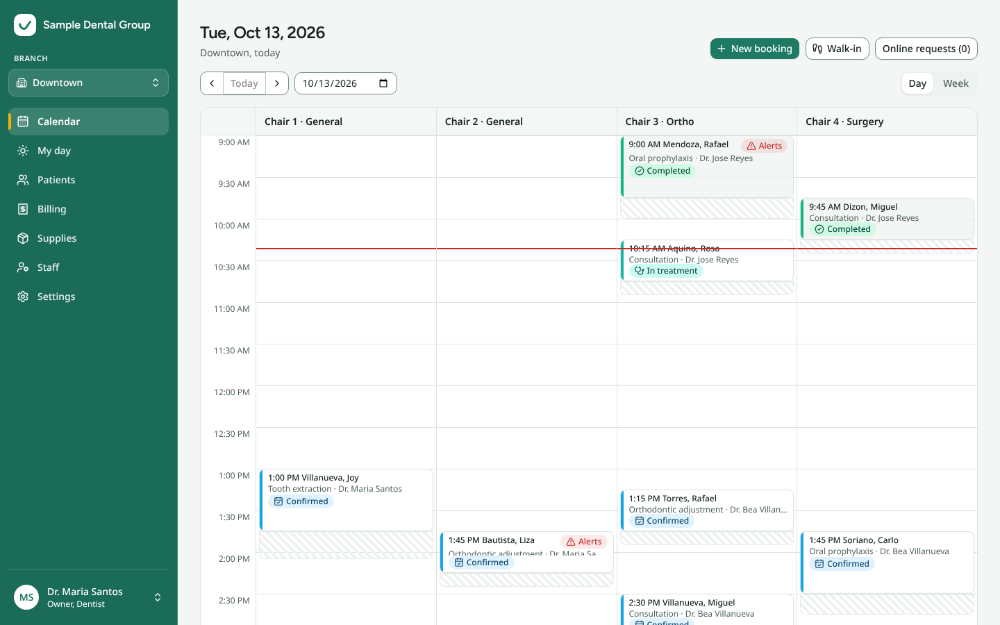
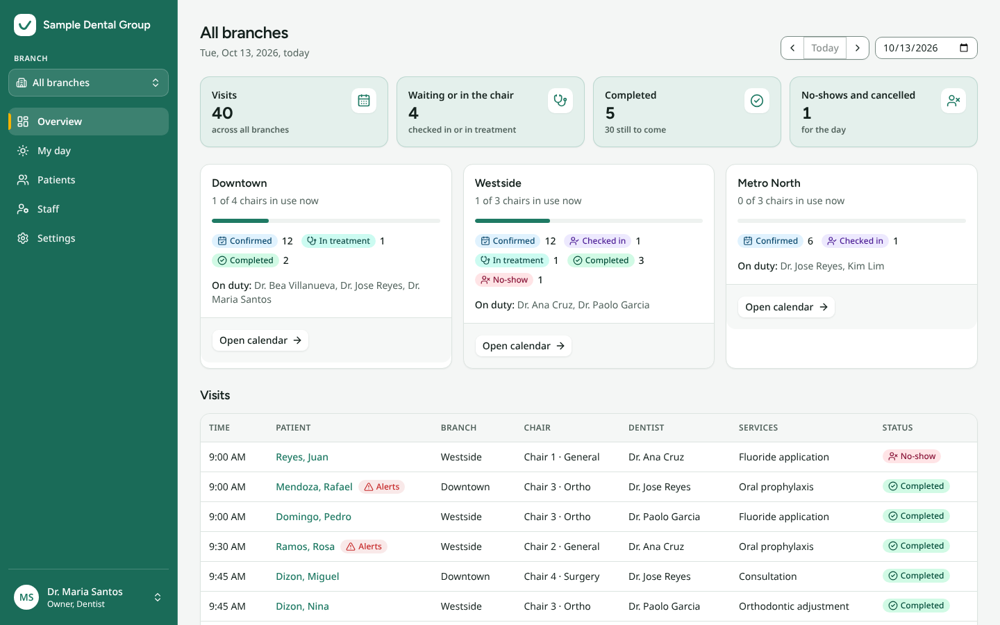
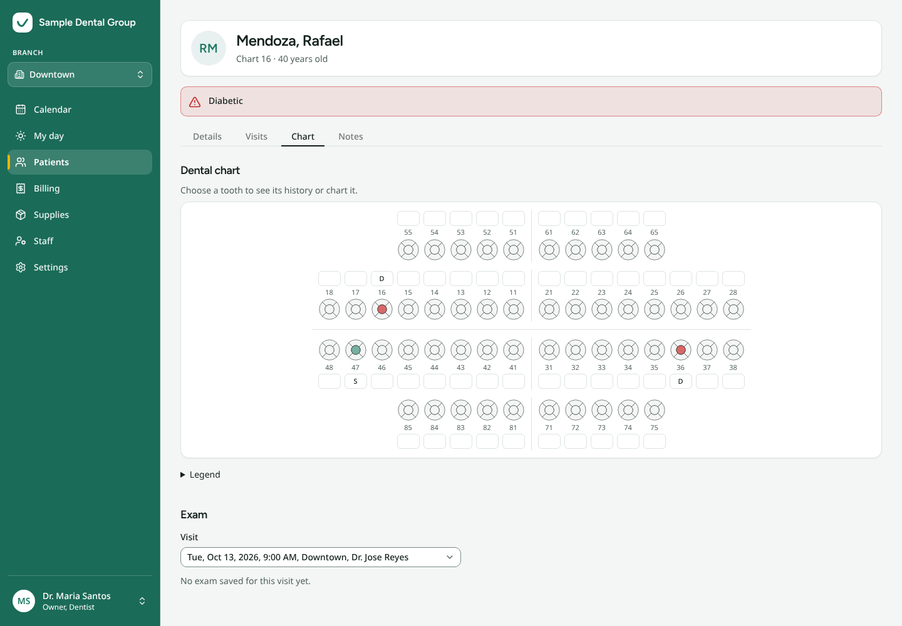
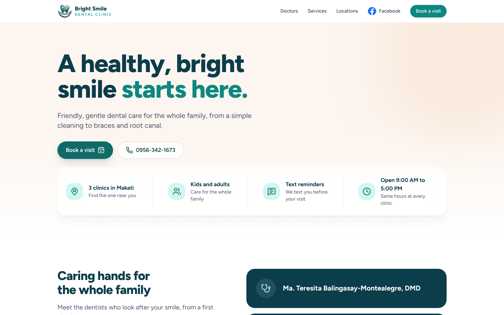
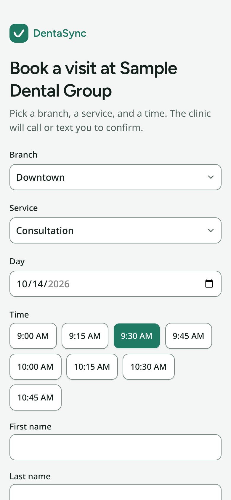
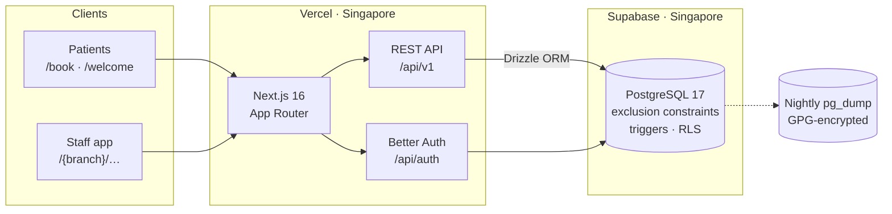

<div align="center">


# DentaSync

**Scheduling, dental charts, and billing for multi-branch dental practices.**

Built for and running at [Bright Smile Dental Clinic](https://www.brightsmile.pro), three branches in Makati, Philippines.

[**Live site**](https://www.brightsmile.pro) · [**Book a visit**](https://www.brightsmile.pro/book) · [Deployment guide](docs/deployment.md) · [Report an issue](https://github.com/Kaizweeen/BrightSmile/issues)


<br />



</div>

---

## Why DentaSync

A dental practice with several branches juggles dentists who move between clinics, chairs that need cleaning between patients, walk-ins, online requests, and paper charts. DentaSync puts all of it in one app, and lets the **database** enforce the rules that must never break:

- 🦷 **No double booking, ever.** A dentist, chair, or patient can't be in two places at once, including chair cleaning time and across branches. PostgreSQL exclusion constraints guarantee it, not just the UI.
- 📋 **Charts that hold up.** PDA dental charts with FDI numbering. Records are never edited or deleted, only voided with a reason.
- 📱 **Patients book from their phone.** Online booking and QR patient forms, with no app or account to install.
- 🧾 **Money that adds up.** Gap-free official receipt numbers, end-of-day cash reconciliation, and days that lock once closed.
- 🔒 **Private by design.** Built for the Philippine Data Privacy Act: every record view is logged, data stays in Singapore, backups are encrypted.

## Screenshots

<table>
  <tr>
    <td width="50%"><br /><sub><b>All-branches overview:</b> live chair use, visit states, and who's on duty at every branch</sub></td>
    <td width="50%"><br /><sub><b>Dental chart:</b> FDI numbering, five surfaces per tooth, medical alerts up front</sub></td>
  </tr>
  <tr>
    <td width="50%"><br /><sub><b>Clinic website:</b> the public landing page patients find first</sub></td>
    <td width="50%" align="center"><br /><sub><b>Online booking:</b> branch, service, time, done</sub></td>
  </tr>
</table>

<sub>Screenshots use the fictional demo data from <code>npm run seed</code>.</sub>

## Features

<details open>
<summary><b>Scheduling</b></summary>

- Chair calendar (day and week), a dentist's **My day**, and an all-branches overview
- Conflicts on dentist, chair, and patient refused by the database, including turnover time and cross-branch bookings
- Hard stops vs. warnings: "Book anyway" for overtime or outside clinic hours
- Enforced visit lifecycle: **Requested → Confirmed → Checked in → In treatment → Completed**, plus No-show and Cancelled
- Dentist weekly schedules, days split across branches, and time off
- Walk-ins and an Online requests queue for the front desk
</details>

<details>
<summary><b>Clinical records</b></summary>

- PDA dental chart: FDI numbering, five surfaces per tooth, the full PDA legend
- Exams: periodontal, occlusion, appliances, TMD, X-rays
- Treatment notes, visit history, and medical alerts
- Append-only: entries are voided with a reason, never edited or deleted
</details>

<details>
<summary><b>Patient-facing</b></summary>

- Clinic landing page with services in English and Tagalog (*Bunot*, *Pasta*, *Pustiso*)
- Online booking at `/book`; DentaSync assigns a dentist and chair, the front desk confirms
- QR patient form at `/welcome/{branch}` that the front desk turns into a chart
- Spam protection: honeypot field, per-connection limits, and a firewall rate limit
</details>

<details>
<summary><b>Billing and supplies</b></summary>

- Checkout from a completed visit, or a walk-in sale
- Cash (with change) or QR payment
- Gap-free official receipts (`OR-{BRANCH}-{YYYYMMDD}-{000001}`), printable
- Voids with a reason; end-of-day over/short reconciliation; closed days lock
- Money stored as integer centavos
- Per-branch stock with reorder levels, taken out automatically when a visit completes
</details>

<details>
<summary><b>Staff and accounts</b></summary>

- Staff join by scanning their branch's QR poster; a manager or the owner approves
- One-time QR password reset links (15 minutes, stored hashed)
- Disabling an account signs it out at once and lists the visits to move
- First-run setup at `/setup`
</details>

### Roles

| Role | Access |
|---|---|
| **Owner** | Everything, at every branch: settings, the access log, and charts if they see patients |
| **Manager / front desk** | Book, confirm, check in, bill, close the day, and approve staff at their branches. Reads charts, never writes them |
| **Dentist** | Own calendar and My day; treats and completes own visits; writes charts, exams, and notes |
| **Patient** | No account: the public booking page and patient form only |

## Architecture



- **One full-stack app.** Next.js serves the clinic site, the staff app, and the API from one deployment.
- **Rules live in the database.** Exclusion constraints stop double booking and triggers enforce the visit lifecycle, so no code path can get around them.
- **One permission check.** Every request goes through `can(user, action, target)` on the server.
- **No third-party services.** No SMS, email, or payment gateway; patient data goes nowhere but the database.

### Tech stack

| | |
|---|---|
| **Framework** | Next.js 16 (App Router), React 19, TypeScript |
| **UI** | Tailwind CSS 4, shadcn/ui, Lucide icons, light and dark mode |
| **Data** | TanStack Query 5, Zod 4 validation on every input |
| **Database** | PostgreSQL 17 with Drizzle ORM; [PGlite](https://pglite.dev) in development and tests |
| **Auth** | Better Auth: username sign-in, Postgres sessions |
| **Testing** | Vitest (unit, database, API) and Playwright (end-to-end) |
| **Hosting** | Vercel (`sin1`) and Supabase, both in Singapore |

## Quick start

No database to install: development runs Postgres inside the app with PGlite.

```bash
git clone https://github.com/Kaizweeen/BrightSmile.git dentasync
cd dentasync
npm install
cp .env.example .env.local    # set BETTER_AUTH_SECRET and SETUP_TOKEN
npm run seed                  # demo practice: 3 branches, staff, 40 patients
npm run dev                   # → http://localhost:3700
```

Generate each secret (32+ characters) with:

```bash
node -e "console.log(require('crypto').randomBytes(32).toString('base64url'))"
```

`npm run seed` prints the demo usernames (`owner`, `downtown.desk`, `dr.reyes`, …) and a password shown only once. Sign in as each role to see the app from their side, and try booking at http://localhost:3700/book. To start fresh, delete `.data/dev` and seed again. Without the seed, open `/setup` to create a practice from scratch.

### Configuration

| Variable | Required | Description |
|---|---|---|
| `DATABASE_URL` | Production | Postgres connection string. Defaults to `pglite:.data/dev` in development |
| `BETTER_AUTH_SECRET` | ✅ | Session signing secret, 32+ random characters |
| `SETUP_TOKEN` | ✅ | One-time code for `/setup`; also the owner's own password reset |
| `APP_URL` | Production | Public origin, no trailing slash. Printed on QR posters |
| `CLIENT_IP_HEADER` | — | Visitor IP header for rate limits. Detected automatically on Vercel and Netlify |

In production the server refuses to start if a required variable is missing or `DATABASE_URL` points at PGlite.

## Development

| Command | Description |
|---|---|
| `npm run dev` | Dev server on port 3700; the database migrates itself |
| `npm run seed` | Load demo data (PGlite, with the dev server stopped) |
| `npm test` | Unit, database, and API tests: 300+, no network needed |
| `npm run test:e2e` | Playwright end-to-end run on port 3701 |
| `npm run lint` | ESLint |
| `npm run typecheck` | TypeScript |
| `npm run build` / `npm start` | Production build and server |
| `npm run db:generate` | New Drizzle migration from `src/db/schema.ts` |
| `npm run db:migrate` | Apply `drizzle/` to the production database |

### End-to-end tests

`npm run test:e2e` starts a fresh server and database and walks a full practice day: setup, a staff QR join and approval, a visit from booking through charting to completion, an online booking confirmed by the front desk, and a patient form turned into a chart.

- Stop `npm run dev` first; both share `.next`.
- Install a browser once with `npx playwright install chromium`, or use your own Chrome with `PLAYWRIGHT_CHANNEL=chrome`.
- Run it before 23:00 Manila time: the test visit must end the same day.

### Project structure

```
src/
├── app/
│   ├── [branch]/      Staff app: calendar, my-day, patients, billing, supplies, staff, settings
│   ├── api/v1/        REST API, including the public patient portal
│   ├── clinic/        Clinic landing page
│   ├── book/          Online booking
│   └── welcome/       QR patient form
├── components/        UI components (shadcn/ui in components/ui)
├── db/                Drizzle schema and connection
├── lib/               Domain rules: permissions, booking, lifecycle, billing, time
└── server/            Server logic for each API resource
drizzle/               SQL migrations: tables, rules, row-level security
tests/                 unit/ · db/ · api/ · e2e/
docs/                  Deployment guide, design specs, plans
```

## API

DentaSync has a versioned REST API at `/api/v1` covering appointments, availability, patients, charts, exams, notes, billing, branches, chairs, dentists, schedules, staff, supplies, and the audit log. The public portal lives at `/api/v1/portal/{bookings,times,forms}`, and auth at `/api/auth`.

Every error has one shape:

```json
{ "error": { "code": "...", "message": "...", "fields": {}, "conflicts": [], "warnings": [] } }
```

`400` invalid input · `401` signed out · `403` forbidden · `404` not found · `409` clash (such as a double booking) · `422` rule broken · `429` rate limited

## Security and privacy

DentaSync is built for the Philippine **Data Privacy Act of 2012 (RA 10173)**.

| | |
|---|---|
| **Audit trail** | Sign-ins, every view of a patient record, and every change, in an access log the owner reviews |
| **Access control** | Server-side permission check on every request; row-level security on every table |
| **Sessions** | Hashed passwords, 12-hour httpOnly sessions, rate-limited sign-in, cross-origin writes refused |
| **Headers** | CSP with a per-request nonce, HSTS, frame-deny, nosniff |
| **Data residency** | Database and app servers in Singapore; nightly backups encrypted to the owner's GPG key |
| **Minimal logging** | Patient details are never logged; rate limits store a keyed hash of the visitor's address, never the address |

Found a security issue? Please report it privately to the maintainer rather than opening a public issue.

## Deployment

Production runs on **Vercel** and **Supabase**, both in Singapore. The [deployment guide](docs/deployment.md) covers the whole path: database setup, migrations, environment variables, first-run configuration, the firewall rate-limit rule, encrypted nightly backups, and go-live checks.

## Documentation

- [Deployment guide](docs/deployment.md): going live, backups, and operations
- Design specs: [scheduling](docs/superpowers/specs/2026-09-29-dentasync-part-1-scheduling-design.md) · [online booking](docs/superpowers/specs/2026-09-29-dentasync-online-booking-design.md) · [patient forms](docs/superpowers/specs/2026-09-29-dentasync-patient-forms-design.md) · [billing](docs/superpowers/specs/2026-10-01-billing-design.md)
- [Implementation plans](docs/superpowers/plans/)
- [Clinic landing page brief](PRODUCT.md)

## Roadmap

- [ ] SMS and email reminders
- [ ] Patient accounts
- [ ] Reports and analytics
- [ ] VAT and discounts
- [ ] Lot-based inventory with expiry dates
- [ ] Payment gateway
- [ ] Two-factor sign-in

## License

Proprietary. © 2026 Bright Smile Dental Clinic. All rights reserved.
